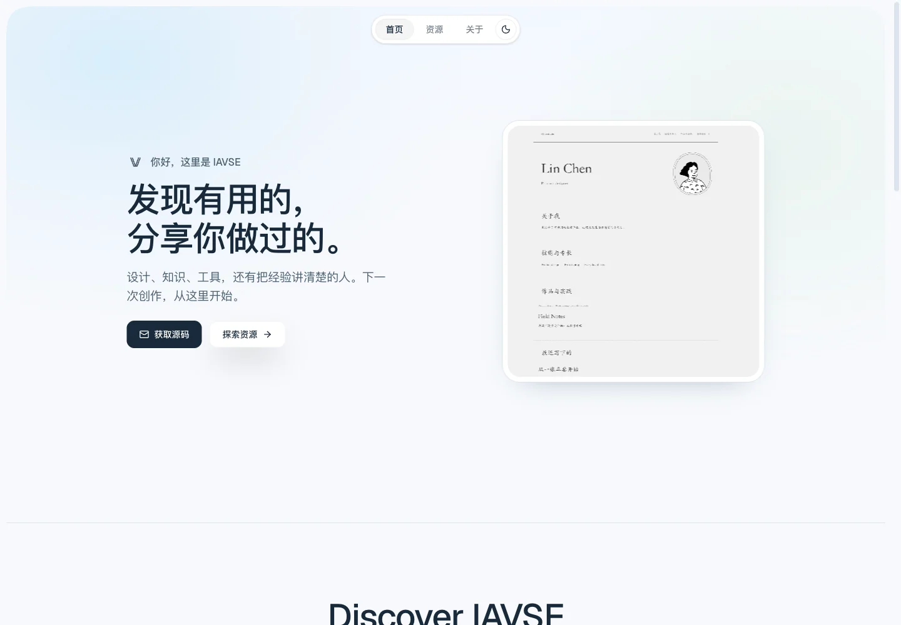
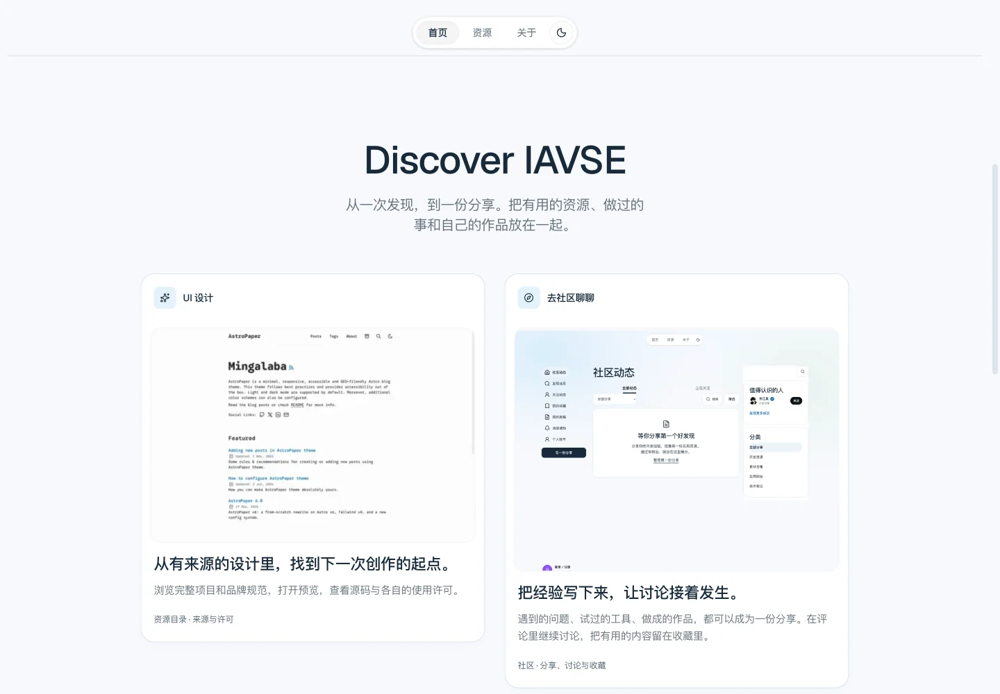
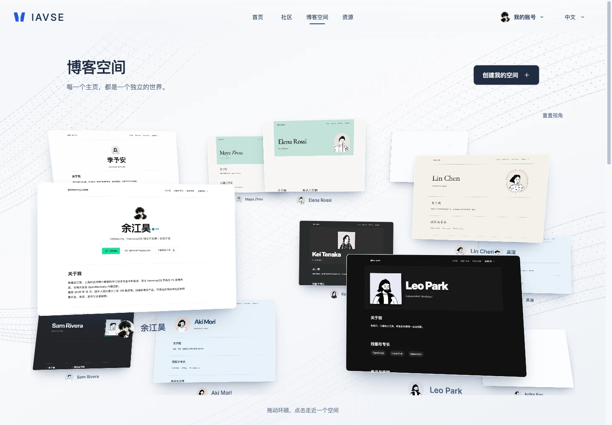
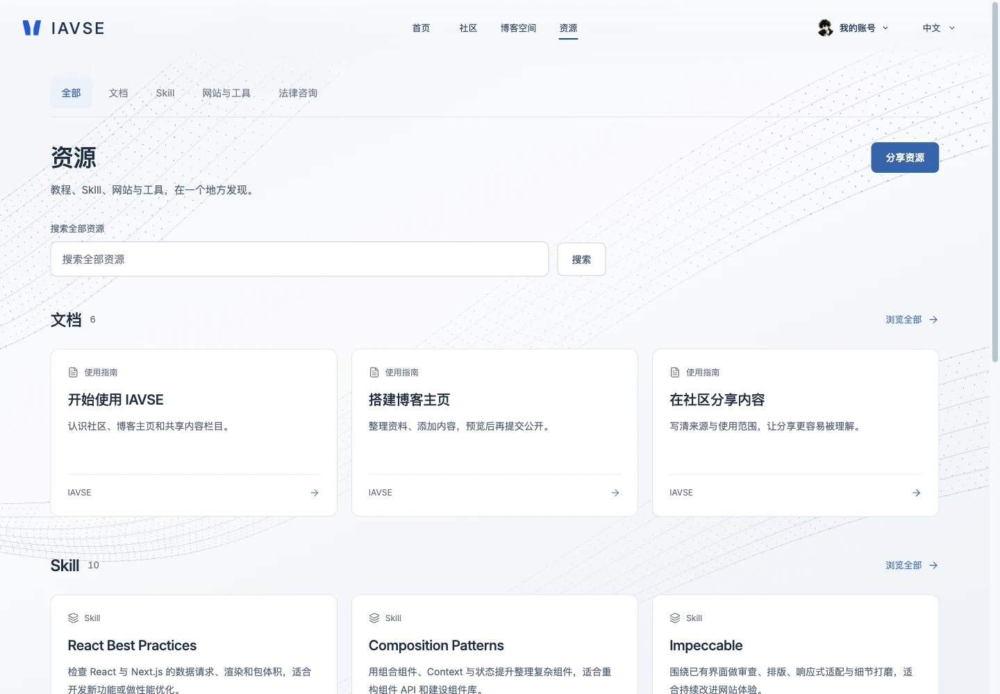
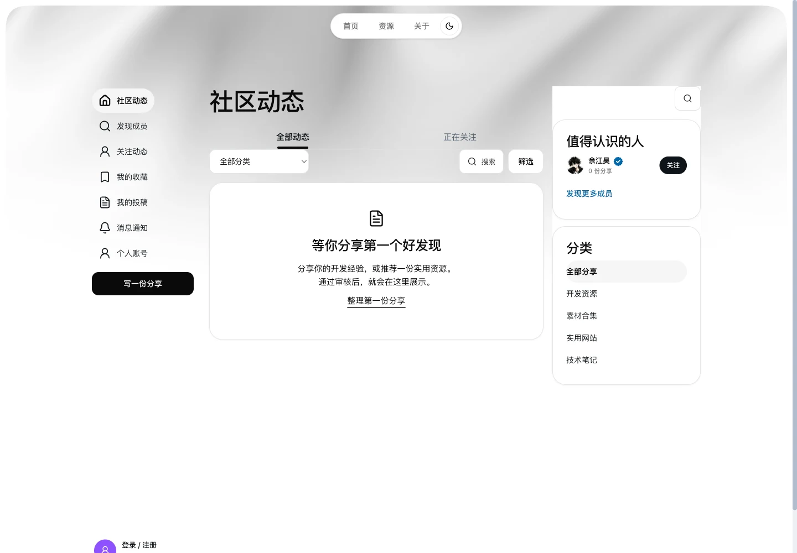
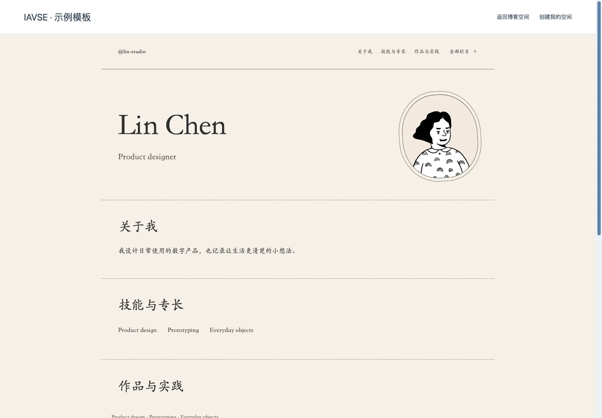

<div align="center">

<picture>
  <source media="(prefers-color-scheme: dark)" srcset="docs/brand/wordmark-dark.svg">
  <source media="(prefers-color-scheme: light)" srcset="docs/brand/wordmark-light.svg">
  
</picture>

**A place for creators to discover resources, share practice and build a homepage.**

Find useful designs, guides and AI Skills. Share what you have learned.
Arrange your work, experience and writing in a visual canvas.


[](https://github.com/IntMainJhy/IAVSE/actions/workflows/ci.yml)
[](https://github.com/IntMainJhy/IAVSE/stargazers)
[](LICENSE)
[](package.json)
[](package.json)
[](tsconfig.json)
[](package.json)

[简体中文](README.md) · **English**

[Features](#features) · [Preview](#preview) · [Quick start](#quick-start) · [Learn from the code](#learn-from-the-code) · [Documentation](docs/README.md) · [Report an issue](https://github.com/IntMainJhy/IAVSE/issues)

</div>



## About IAVSE

**Insight through AI. Vigilance for Opportunity. Seize to Evolve.**

IAVSE is a self-hostable creator community and blog platform. Discover design templates and tools, publish documents and experience, or import a résumé and arrange a personal homepage. Profiles, private drafts, uploads and public versions belong to the signed-in account.

This repository contains the website frontend, backend, tests, AI integrations and deployment examples. Explore how a Next.js application implements a visual editor, Three.js interaction, content publishing and account isolation. Development continues; production deployment, email delivery and public community access require validation in the target environment.

> Original website material uses **[PolyForm Noncommercial 1.0.0](LICENSE)**. Noncommercial study, use, deployment, modification and redistribution are permitted within its terms. Commercial use needs separate permission. Retain the original-author and source notices in [NOTICE](NOTICE). Third-party licenses remain unchanged. Private macOS / Windows client source, installers and live site data are outside this repository.

## Features

| Area | Implemented capabilities |
| --- | --- |
| Resource discovery | UI templates, guides, independent AI Skills, websites and tools; purpose, industry and style filters; original sources and licenses |
| Community | Posts, comments, follows, bookmarks, member profiles, notifications, search and categories; truthful empty and moderation states |
| Blog spaces | A public blog directory, personal homepages and built-in examples; six editor layouts and eight visual themes |
| Visual canvas | Inline editing, layers, properties, drag-and-drop, width and position controls, undo/redo, desktop and mobile preview |
| Résumé import | Local text extraction from PDF / DOCX / TXT / Markdown; review a private profile draft before choosing what becomes public |
| Publishing | Private drafts, fixed public snapshots, revisions and takedowns; original text posts can publish automatically, flagged posts and documents go to review |
| Documents | Rich text, heading outline, code, tables, images, imports and private document autosave |
| AI integration | IAVSE Skill, REST API and local stdio MCP bridge; scoped credentials for saving drafts and submitting content |
| Administration | Reviews, reports, account restrictions, files, audit history and measured PV / UV |
| Operations | SQLite, private file storage, backup/restore, cleanup scripts, Nginx / systemd and separate platform/admin examples |
| Languages | Simplified Chinese, English and Japanese; desktop, tablet, mobile and reduced-motion support |

## Preview

Captured from the actual local production build on **2026-11-10**, showing the independent IAVSE design refinement. Working-tree source hashes and the source base are recorded in the adjacent [captures.json](docs/screenshots/captures.json). Bundled showcase profiles are labeled examples; community captures retain the actual empty state. See [capture details](docs/screenshots/README.md).

### Homepage and content entry points

The current **IAVSE design system** independently refines the existing application with self-hosted Geist (the IAVSE Sans CSS alias), cool light and deep-blue canvases, blue-gray type, pale content groups and shared controls. [RBP Portfolio](https://github.com/DavidHDev/rbp-portfolio) remains the component and interaction baseline: Hero → four Projects cards → Contact, with the three-link public capsule. Type, spacing, card surfaces and the CSS atmosphere are IAVSE refinements. Cloudlight informed general design principles; the cancelled direct template migration remains cancelled, with no Cloudlight code, shader or assets included. Community, catalogs, accounts, administration and the editor retain their functional layouts with IAVSE controls and first-viewport entry motion. Authored canvases, published themes and third-party previews keep their own appearance. See [DESIGN.md](DESIGN.md) and the [frontend notes](docs/portfolio-frontend.md) for current rules, source mapping and license boundaries.



### Blog discovery and personal homepages



<details>
<summary>More views: resource catalog, community and a built-in homepage</summary>







</details>

## Quick start

Install **Node.js 24.15+**, npm and Git. SQLite comes from Node.js; a separate database server is not required for local development.

```sh
git clone https://github.com/IntMainJhy/IAVSE.git
cd IAVSE
npm ci
cp .env.local.example .env.local
node --env-file=.env.local scripts/setup.mjs
npm run dev
```

Open **http://127.0.0.1:3008/**. The repository root is the website root. Preserve an existing `.env.local` instead of overwriting it.

- Setup prints the private data directory. First-run administrator credentials are written to its `initial-admin.txt`; setup does not reset an existing password.
- The default data directory is `../.site-v1-data`, outside the checkout. Pin `APP_DATA_DIR` to the existing absolute data path when continuing a site.
- Keep the hostname and port in `PUBLIC_URL` identical to the browser address. Standalone Node scripts need `--env-file=.env.local`.
- Registration uses email/password plus explicit rule acknowledgment, without an email challenge. Email verification and password recovery require SMTP.

Read [local setup and validation](docs/getting-started.md) or [troubleshooting](docs/troubleshooting.md) for data, port, sign-in and mail issues.

## Development and validation

```sh
npm test                 # Unit and regression tests with isolated data
npm run build            # Generate brand/Skill exports and build the website
npm run typecheck        # TypeScript validation
npm run docs:check       # Documentation links, images and repository entry points
npm start                # Serve the built website on port 3008
```

Run HTTP suites as needed, including `npm run test:homepage:http`, `npm run test:gallery:http` and `npm run test:registration:http`. They use temporary data and their own ports; never point them at an existing site's data directory.

GitHub Actions checks documentation, unit tests, the production build and types on `main` pushes and pull requests. See the actual results in [Actions](https://github.com/IntMainJhy/IAVSE/actions).

## Learn from the code

| Topic | Starting point |
| --- | --- |
| Next.js pages, routing and server composition | [Architecture guide](docs/architecture.md), `src/app/`, `src/components/AppPage.tsx` |
| Blog canvas and templates | [Editor guide](docs/blog-editor.md), `src/components/BlogCanvas.tsx`, `src/lib/blog-templates.mjs` |
| Drafts, public versions and authorization | [Publication boundaries](docs/public-launch.en.md), `src/lib/spaces.mjs`, `src/lib/community.mjs` |
| Catalog queries, filters and performance | [Resource discovery](docs/resource-discovery.md), [catalog measurements](docs/catalog-performance-2026-11-08.md) |
| IAVSE design system and viewport entry | [Visual specification](DESIGN.md), [integration and upstream mapping](docs/portfolio-frontend.md), `src/app/iavse-system.css`, `src/lib/rbp-motion.mjs`, `src/components/rbp/` |
| AI Skill / MCP / REST | [IAVSE Skill](integrations/iavse-post/SKILL.md), [API reference](integrations/iavse-post/references/api.md), `integrations/iavse-mcp.mjs` |
| Isolation, tests and recovery | `test/`, [administration](docs/administration.en.md), `scripts/backup.mjs`, `scripts/restore.mjs` |

Start with one page and its tests, then follow its API and data modules. [DESIGN.md](DESIGN.md) is the only platform visual specification; earlier implementations remain in Git history. Third-party design guides in the catalog are learning content. Dated feature and performance records describe their original versions and measurement scope.

## Deployment and data

The recommended deployment shares one codebase and data store between separate platform and administration entry points. `APP_SURFACE`, origin checks and server-side authorization separate their access.

- [Separate platform/admin deployment](deploy/README-split.en.md)
- [Production and public-operation requirements](docs/public-launch.en.md)
- [Platform environment](deploy/platform.env.example) · [Admin environment](deploy/admin.env.example) · [Nginx example](deploy/nginx-split.conf.example)

Use private persistent storage, actual HTTPS URLs and the correct proxy/cookie settings. Production accounts and community features are explicitly enabled by deployment configuration. Databases, user uploads, mail, keys, initial credentials and backups stay outside Git.

Saving and publishing are separate actions. Original text posts can publish automatically. Flagged posts, shared documents and document revisions go to review. Homepages, projects, Skills, resources, comments and replies publish under the existing account, sanitization, rate-limit, reporting and takedown rules. The site owner's homepage has specific save behavior documented in the [editor guide](docs/blog-editor.md).

Static hosting accepts constrained HTML / ZIP packages with relative assets, without arbitrary server execution; see [hosting limits](docs/blog-hosting.md). AI credentials are scope-limited, and saving is separate from submitting. The legacy `/workspace/connect` route redirects to the editor; use the [API credential instructions](integrations/iavse-post/references/api.md#credential-setup-local-accounts).

## Repository layout

```text
IAVSE/
├── src/app/          # Pages, API routes, route styles and metadata
├── src/components/   # Public UI, canvas, community and administration
├── src/lib/          # Data, permissions, catalog, publishing and media
├── integrations/     # IAVSE Skill, stdio MCP and REST clients
├── scripts/          # Setup, brand exports, docs checks, backup and restore
├── test/             # Unit, component and isolated HTTP regression suites
├── deploy/           # Environment, Nginx and systemd examples
├── public/           # Website assets and downloadable Skill package
├── docs/             # Guides, architecture, screenshots, design and licenses
└── .github/          # CI, issue forms and pull request template
```

## Documentation and community

[Documentation](docs/README.md) · [Changelog](CHANGELOG.md) · [Contributing](CONTRIBUTING.md) · [Support](SUPPORT.md) · [Security reporting](SECURITY.md) · [Code of conduct](CODE_OF_CONDUCT.md)

Reproducible bug reports, documentation, translation, accessibility and performance contributions are welcome. Explain the real use case in a feature request and the behavior change and validation in a pull request.

If this repository helped you understand an implementation or informed something you are building, [give IAVSE a Star on GitHub](https://github.com/IntMainJhy/IAVSE). Share what you learned with the original author and source credited.

## License and attribution

Original website code and material use [PolyForm Noncommercial 1.0.0](LICENSE). Its noncommercial restriction makes this a source-available project, rather than OSI-defined open source. Commercial use needs separate permission.

Redistribution must preserve the license and both `Required Notice` lines in [NOTICE](NOTICE). Credit your original changes without claiming the existing project as your own. Third-party code, fonts, icons, templates and media retain their terms; see [THIRD_PARTY_NOTICES.md](THIRD_PARTY_NOTICES.md). The README wordmark uses vector outlines of the bundled Cormorant Garamond typeface under SIL OFL; see [brand assets](docs/brand.md).

[GitHub](https://github.com/IntMainJhy/IAVSE) · [AtomGit mirror](https://atomgit.com/InMainJhy/IAVSE) · [Original author: IntMainJhy](https://github.com/IntMainJhy)
