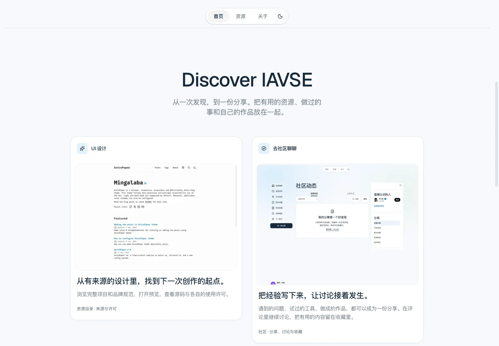

<div align="center">

<picture>
  <source media="(prefers-color-scheme: dark)" srcset="docs/brand/wordmark-dark.svg">
  <source media="(prefers-color-scheme: light)" srcset="docs/brand/wordmark-light.svg">
  
</picture>

**为开发者与创作者，连接资源、交流与个人主页。**

发现实用的设计、文档与 AI Skill，分享你的实践，
用可视化画布整理自己的作品、经历与文字。


[](https://github.com/IntMainJhy/IAVSE/actions/workflows/ci.yml)
[](https://github.com/IntMainJhy/IAVSE/stargazers)
[](LICENSE)
[](package.json)
[](package.json)
[](tsconfig.json)
[](package.json)

**简体中文** · [English](README.en.md)

[功能概览](#功能概览) · [界面预览](#界面预览) · [快速开始](#快速开始) · [学习路线](#学习路线) · [文档中心](docs/README.md) · [问题反馈](https://github.com/IntMainJhy/IAVSE/issues)

</div>


## 关于 IAVSE

**Insight through AI. Vigilance for Opportunity. Seize to Evolve.**
以洞察驱动智能，以敏锐发现机遇，以行动实现进化。

IAVSE 是一个可自行部署的创作者社区与博客平台。它将资源发现、实践分享和个人主页放在同一套账号体系中：你可以浏览设计模板与工具，发布文档和经验，也可以导入简历，在画布里编辑一个自己的主页。

本仓库包含网站前端、后端、测试、AI 接入与部署示例，适合学习 Next.js 全栈应用、可视化编辑器、Three.js 交互、内容发布及账号隔离的实现。当前仍在持续开发；生产部署、邮件投递和社区开放需要在实际环境中单独验收。

> 网站原创部分采用 **[PolyForm Noncommercial 1.0.0](LICENSE)**，允许协议范围内的非商业学习、使用、部署、修改与再分发。商业使用须另行授权。再分发保留 [NOTICE](NOTICE) 中的原作者与项目来源声明，第三方材料保留各自许可。macOS / Windows 客户端源码、安装包和真实站点数据不在本仓库。

## 功能概览

| 模块 | 已实现的能力 |
| --- | --- |
| 资源发现 | UI 模板、文档、独立 AI Skill、网站和工具目录；按类型、用途、行业与风格筛选，查看原始来源和许可 |
| 社区交流 | 投稿、评论、关注、收藏、成员资料、消息、搜索和分类；保留真实空状态与审核状态 |
| 博客空间 | 公开博客目录、个人主页与内置示例；编辑器提供六种布局与八种视觉主题 |
| 可视化画布 | 内联编辑、图层、属性、拖放、宽度与位置、撤销重做、桌面与手机预览 |
| 简历导入 | PDF / DOCX / TXT / Markdown 本地文本提取；先检查生成的资料草稿，再选择公开内容 |
| 内容发布 | 私有草稿、固定公开快照、修订与下线；社区文章和文档需审核，其他支持类型按既有权限直接发布 |
| 文档编辑 | 富文本、标题大纲、代码、表格、图片、导入与文档私有自动保存 |
| AI 接入 | IAVSE Skill、REST API 与本地 stdio MCP 桥；通过独立范围凭据保存草稿和提交发布 |
| 管理中心 | 内容审核、举报处理、账号限制、文件管理、操作记录及实际 PV / UV 统计 |
| 部署维护 | SQLite、私有文件目录、备份恢复、清理脚本、Nginx / systemd 和平台 / 管理端分入口示例 |
| 多语言 | 简体中文、English、日本語；适配桌面、平板和手机，支持减少动态设置 |

## 界面预览

以下为 **2026-11-10** 从 `main` 实际页面拍摄的截图。示例主页不代表真实注册成员或用户背书；社区保留拍摄时的实际空状态。详见[截图说明](docs/screenshots/README.md)。

### 首页与资源工作台

整套前端基于 [RBP Portfolio](https://github.com/DavidHDev/rbp-portfolio) 适配：黑白流动背景、分栏首屏、胶囊导航与图像变形连接真实资源和社区内容。公共页面使用 Lenis 平滑滚动；编辑器与作者主页保留原生操作，支持深浅外观和减少动态。详见[源码映射与实现说明](docs/portfolio-frontend.md)。



### 博客空间与个人主页


<details>
<summary>查看更多界面：资源目录、社区和内置主页示例</summary>


</details>

## 快速开始

需要 **Node.js 24.15+**、npm 和 Git。数据库使用 Node.js 内置 SQLite，首次本地运行无需单独安装数据库服务。

```sh
git clone https://github.com/IntMainJhy/IAVSE.git
cd IAVSE
npm ci
cp .env.local.example .env.local
node --env-file=.env.local scripts/setup.mjs
npm run dev
```

打开 **http://127.0.0.1:3008/**。本仓库根目录就是网站目录。已有 `.env.local` 时保留原配置，不重复覆盖。

- 初始化脚本会打印私有数据目录；首次管理员凭据保存在该目录的 `initial-admin.txt`，重复初始化不会重置密码。
- 默认数据目录是仓库外的 `../.site-v1-data`。继续维护已有站点时，将 `APP_DATA_DIR` 固定为原数据目录的绝对路径。
- `PUBLIC_URL` 的主机名和端口须与浏览器地址一致。Node 脚本需要显式使用 `--env-file=.env.local`。
- 注册使用邮箱和密码，并要求打开和确认当前规则；注册本身不需要邮件验证码。邮箱验证及密码找回需要 SMTP。

更多步骤见[本地运行与验证](docs/getting-started.md)，遇到数据、端口、登录或邮件问题见[故障排查](docs/troubleshooting.md)。

## 开发与验证

```sh
npm test                 # 单元与回归测试，使用隔离数据
npm run build            # 生成品牌导出与 Skill 包，然后构建网站
npm run typecheck        # TypeScript 检查
npm run docs:check       # 文档链接、图片与仓库入口检查
npm start                # 运行已构建的网站，默认 3008
```

HTTP 集成测试按需运行，例如 `npm run test:homepage:http`、`npm run test:gallery:http`、`npm run test:registration:http`。这些脚本使用临时数据和独立端口，不应连接现有站点的数据目录。

GitHub Actions 在 `main` 推送和 Pull Request 时执行文档检查、单元测试、生产构建和类型检查。运行中的结果见 [Actions](https://github.com/IntMainJhy/IAVSE/actions)。

## 学习路线

| 想学习什么 | 从哪里开始 |
| --- | --- |
| Next.js 页面、路由与服务端组织 | [架构与目录导览](docs/architecture.md)、`src/app/`、`src/components/AppPage.tsx` |
| 博客画布与模板 | [编辑器说明](docs/blog-editor.zh-CN.md)、`src/components/BlogCanvas.tsx`、`src/lib/blog-templates.mjs` |
| 草稿、公开版本与权限边界 | [发布说明](docs/public-launch.md)、`src/lib/spaces.mjs`、`src/lib/community.mjs` |
| 目录查询、筛选与性能 | [资源目录实现](docs/resource-discovery.md)、[目录性能记录](docs/catalog-performance-2026-11-08.md) |
| Portfolio 前端、WebGL 与平滑滚动 | [当前前端实现与上游映射](docs/portfolio-frontend.md)、`src/components/portfolio/`、`src/app/portfolio-foundation.css` |
| AI Skill / MCP / REST | [接入 Skill](integrations/iavse-post/SKILL.md)、[API 参考](integrations/iavse-post/references/api.md)、`integrations/iavse-mcp.mjs` |
| 账号隔离、测试与恢复 | `test/`、[管理文档](docs/管理中心说明.md)、`scripts/backup.mjs`、`scripts/restore.mjs` |

建议从一个具体页面及其测试读起，再追踪对应 API 和数据模块。历史设计与性能记录标有日期，结论只对应当时的版本和测量范围；旧版[首页混合参考方案](docs/home-react-bits.md)与[首页产品空间设计](docs/home-product-redesign.md)仅供历史参考。

## 部署与数据

推荐一套代码和数据、两个独立入口：平台供成员使用，管理端供管理员使用。通过 `APP_SURFACE`、同源校验和服务端权限限制访问。

- [平台 / 管理端分入口部署](deploy/README-split.md)
- [生产环境与公开运营要求](docs/public-launch.md)
- [平台环境示例](deploy/platform.env.example) · [管理端环境示例](deploy/admin.env.example) · [Nginx 示例](deploy/nginx-split.conf.example)

生产环境使用私有持久数据目录、实际 HTTPS 地址及正确的代理和 Cookie 配置。公网账号和社区功能由部署配置显式启用。数据库、用户上传、邮件、密钥、初始凭据和备份均不提交 Git。

保存草稿和公开发布是不同操作。社区文章、共享文档及其修订需要审核；博客主页、项目、Skill、资源、评论和回复按现有规则直接公开，并继续受账号权限、内容清理、限流、举报与下架约束。站长主页存在特定保存行为，详见[博客编辑指南](docs/blog-editor.zh-CN.md)。

静态网站托管支持受限的 HTML / ZIP 包及相对素材，不提供任意服务端执行；具体限制见[静态托管说明](docs/blog-hosting.zh-CN.md)。AI 凭据按范围授权，保存与提交分别处理；现有 `/workspace/connect` 会跳到编辑器，凭据创建方式以 [API 文档](integrations/iavse-post/references/api.md#credential-setup-local-accounts) 为准。

## 仓库结构

```text
IAVSE/
├── src/app/          # 页面、API、路由样式与元数据
├── src/components/   # 公共界面、画布、社区与管理端
├── src/lib/          # 数据、权限、目录、发布和媒体逻辑
├── integrations/     # IAVSE Skill、stdio MCP 与 REST 客户端
├── scripts/          # 初始化、品牌导出、文档检查、备份恢复
├── test/             # 单元、组件与隔离 HTTP 回归
├── deploy/           # 环境、Nginx 和 systemd 示例
├── public/           # 网站静态资源与可下载 Skill
├── docs/             # 使用指南、架构、截图、设计与许可记录
└── .github/          # CI、问题模板与 Pull Request 模板
```

## 文档与社区

[文档中心](docs/README.md) · [更新记录](CHANGELOG.md) · [贡献指南](CONTRIBUTING.md) · [问题与支持](SUPPORT.md) · [安全报告](SECURITY.md) · [行为准则](CODE_OF_CONDUCT.md)

欢迎提交可复现的问题、文档改进、翻译、无障碍和性能贡献。提出功能建议时说明实际场景，提交 PR 时说明行为变化及验证方式。

如果这个项目帮你理解了一个实现，或成为你下一次创作的参考，欢迎在 [GitHub 给 IAVSE 点一个 Star](https://github.com/IntMainJhy/IAVSE)。也欢迎分享你学到的部分，并保留原作者与项目来源。

## 许可与署名

网站原创代码和材料采用 [PolyForm Noncommercial 1.0.0](LICENSE)。这是带非商业限制的源码公开许可，不属于 OSI 定义的开源许可；商业使用需另行授权。

再分发须保留协议及 [NOTICE](NOTICE) 中的两条 `Required Notice`。可以署名自己的原创修改，不得把既有项目冒称为自己原创。第三方代码、字体、图标、模板与素材保留各自条款，见 [THIRD_PARTY_NOTICES.md](THIRD_PARTY_NOTICES.md)。本页艺术字由已随仓库提供的 Cormorant Garamond 转为矢量轮廓，字体沿用 SIL OFL，说明见[品牌资源](docs/brand.md)。

[GitHub 主仓库](https://github.com/IntMainJhy/IAVSE) · [AtomGit 镜像](https://atomgit.com/InMainJhy/IAVSE) · [原作者 IntMainJhy](https://github.com/IntMainJhy)
