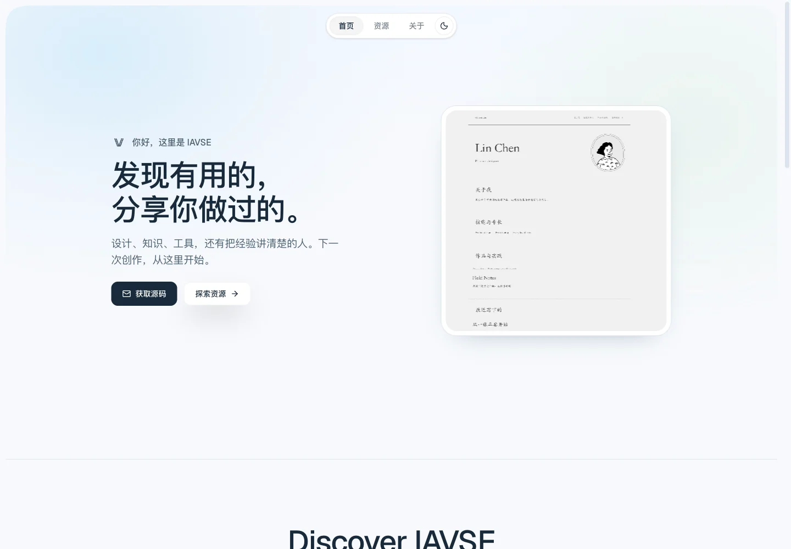
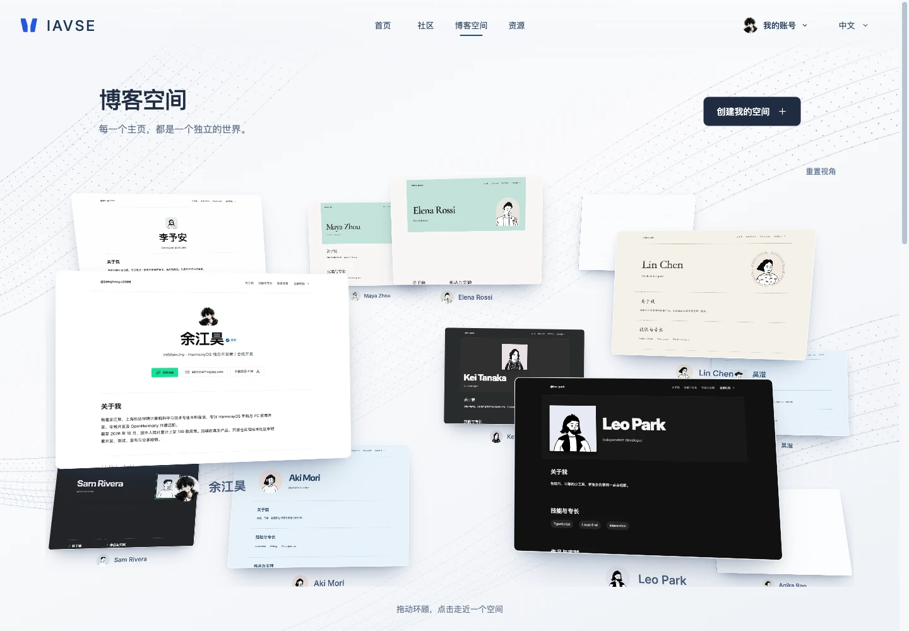
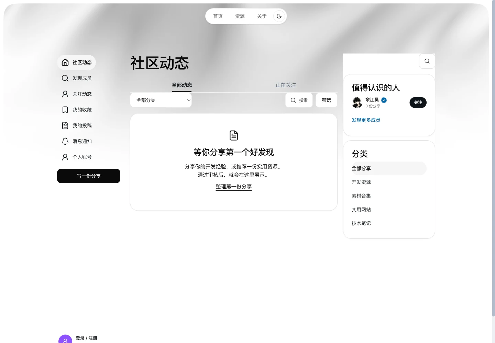
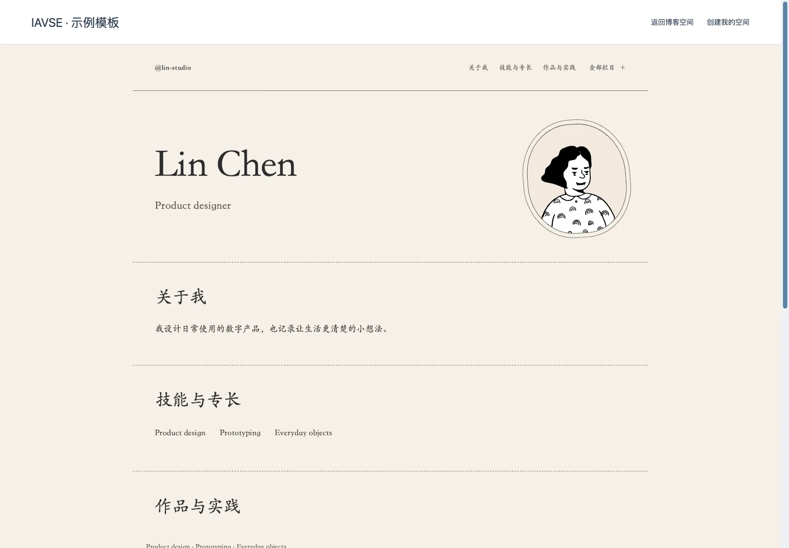
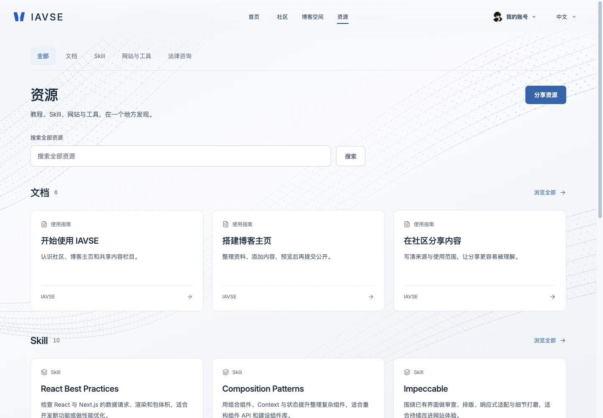
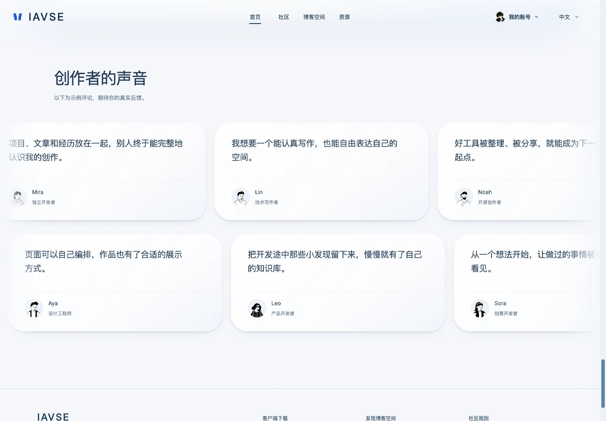

# IAVSE

**English** | [简体中文](README.zh-CN.md)

**Insight through AI. Vigilance for Opportunity. Seize to Evolve.**

INSIGHT · ARTIFICIAL INTELLIGENCE · VIGILANCE · SEIZE · EVOLVE

IAVSE is a developer blog and knowledge-sharing platform. Build a personal homepage from your résumé, arrange it in a visual editor, and share projects, articles, AI Skills and useful resources. Discover other homepages in a 3D spatial gallery. Each member manages their own profile, private drafts and uploaded files.

[GitHub repository](https://github.com/IntMainJhy/IAVSE) · [AtomGit mirror](https://atomgit.com/InMainJhy/IAVSE) · [Documentation](docs/README.md)

This repository contains the website's frontend, backend, tests and deployment examples, making its interface, content model and permission system available to study. It is built with Next.js, React, TypeScript and Node.js's built-in SQLite.

> **Source available for noncommercial use.** Original website material is licensed under [PolyForm Noncommercial 1.0.0](LICENSE), allowing use, modification, deployment and redistribution for its permitted purposes. Commercial use is not granted. This is a source-available license, not an OSI-approved open-source license. Noncommercial study and maintenance contributions are welcome. Retain the original author and project notices; do not claim the original project as your own work. See [NOTICE](NOTICE) for attribution and scope, and [CONTRIBUTING.md](CONTRIBUTING.md) to contribute.

**This repository publishes only the website. macOS and Windows client source code, installers and proprietary assets remain private. This repository's license grants no rights to use or distribute those clients.** Viewing and forking on GitHub remain subject to GitHub's applicable terms.

## What IAVSE is for

- **Developers:** build a shareable résumé homepage with projects, experience, skills and compact certificate galleries.
- **Authors and curators:** publish categorized tutorials, third-party Skills and useful resources, with source and license information.
- **AI-assisted workflows:** let an authorized agent prepare private drafts and submit them through scoped REST credentials or a local stdio MCP bridge.
- **Site operators:** review submitted articles, handle reports and takedowns, manage accounts and inspect real audience statistics and audit history.

IAVSE is being developed as a shared service with account-isolated data. Public accounts and community routes are explicitly enabled for HTTPS deployments; registration requires opening and acknowledging the current community rules and disclaimer. Members can then sign in with their email and password without an email code; that acknowledgment is recorded separately from mailbox verification. Account restrictions and deployment access controls still apply. See [public launch requirements](docs/public-launch.en.md).

## Current release

The current main branch includes the optical blue homepage, macOS download entry, resource transitions and a 12-page spatial blog gallery. The gallery uses existing blog templates, loads two previews at a time, supports drag-to-look and click-to-focus, and honors reduced motion. Published members appear first; bundled showcase profiles do not create accounts or alter member counts. The creator voices section uses illustrative comments, with two scrolling rows, hover feedback, keyboard reading and reduced-motion support.

See the [current repository update](docs/release-2026-11-04.md) and [performance review](docs/performance-2026-11-04.md).

## Preview

Captured from the current website on **2026-11-04**, using its Simplified Chinese interface. English and Japanese are also supported. Showcase profiles and illustrative comments demonstrate the interface; they are not user-count or endorsement claims. [Capture details](docs/screenshots/README.md).

### Homepage

The current optical glass homepage, followed by spaces, the editable canvas, Skills and resources.



### Spatial blog discovery



### Community

Community navigation, search and categories. The current local site has no published community posts, so this capture shows the empty state.



### Blog homepage

The Blog spaces directory lists discoverable published homepages; each opens its own public layout, introduction, skills, experience and work. Editing stays on a separate page: **Create / edit my blog** opens the signed-in member’s own content. The owner can use **Administration → Blog homes** at `/admin/blog`. See the [blog editing guide](docs/blog-editor.md).



### Skills and resources

Independent AI Skills, shared documents and tools are available through resource navigation.



### Creator voices

Illustrative comments introduce the kinds of work the platform supports. Both rows support keyboard reading and reduced motion.



## Features

| Area | Capabilities |
| --- | --- |
| Accounts | Email/password registration without an email code or invitation; opening and acknowledging the current community rules and disclaimer is required. Consent version and hash are checked by the server; email ownership is not marked verified. Production access is explicitly configured |
| Blog homepages | Design the actual Anx template or a blank page; inline editing, layers, properties, width/position controls, custom blocks, undo/redo, dot grid and desktop/mobile preview. Preserve résumé sections, certificates, PDFs and translations; save a private draft, then explicitly publish a fixed homepage version; article content still requires review |
| Existing static website hosting | Backend APIs accept HTML or ZIP packages with relative CSS/JS/assets, isolate previews and explicitly publish fixed homepage versions without pre-review; existing hosted sites and stable sharing URLs remain supported |
| Shared documentation | Title-and-body editor with slash insertion, lists, code, tables, account-scoped inline images, imports and a heading outline; document-only private autosave after 1,600 ms preserves typing. Reading uses library/document/outline navigation |
| Skill directory | Independent upstream Skills with category/search/tool filters, scenarios, installation commands and localized copyable prompts; GSAP is one entry with eight modules and legacy module redirects. Member submissions start with a name and HTTPS URL, with optional description and collapsed metadata |
| Other resources | Share websites, tools and references with a name and HTTPS URL; description is optional and extra metadata is collapsed |
| Publishing & community | Original community posts require only a body, with derived title/summary and optional extras; explicit publication consent and account restrictions still apply. Community posts and shared documents require review; blog layouts, projects, Skills, resources, comments and guestbook entries publish directly. Published catalog entries create one linked share, revisions reuse it, and takedowns stop its public visibility |
| Sharing & community profiles | Direct public blog navigation, public links, system sharing and QR codes; community profiles retain a short introduction with a link to the full blog |
| Résumé import | Local PDF, DOCX, TXT and Markdown text extraction into a reviewable profile draft; original uploads stay private, and a separate redacted PDF can be selected for public download |
| Content and files | Private account-isolated drafts, versions, blog content, uploaded images, attachments and file references |
| Moderation & administration | Article/document review, post-publication reports and takedowns, account controls, notifications and audit logs. The dashboard shows database-backed registered users, account status, new registrations, public spaces, content, storage and measured PV/UV, with date-range traffic details |
| AI integration | The IAVSE Skill and local stdio MCP bridge can read, save and submit documents, Skills and resources through scoped credentials; publication uses the same moderation and community-sharing pipeline as the editor |

The download page can link to externally hosted client installers. Client binaries and source code are not stored in this repository.

## Interface and interaction

Deep navy, cobalt and porcelain surfaces connect the homepage and platform interface. The homepage uses a live Three.js glass surface with refraction, reflection and restrained dispersion, followed by a particle field. Spaces, the editable canvas, Skills and resources follow native document scrolling straight through to the footer. GSAP ScrollTrigger provides light, one-time entrances without a pinned stage or screen-by-screen transitions. The canvas is an operable product demo, the Skill card plays a real interface recording, and the resource card uses a separate interactive 3D scene. Fine-pointer hover interactions add a local dot-lattice response.

The header places the brand at the left, navigation at the center, and account and language controls at the right. Mobile and reduced-motion layouts use native document flow. Inactive chapters do not initialize video or 3D cards; previously loaded media pauses or uses demand rendering offstage. Global and per-card pause controls, reduced motion, hidden-tab suspension, loading/error fallbacks and renderer cleanup preserve usability and limit unnecessary work.

The interface supports English, Simplified Chinese and Japanese across desktop, tablet and mobile. The editor uses restrained blue accents and pale working surfaces; authored blog themes retain their own saved colors. Desktop public pages follow the saved design; narrow screens maintain a stacked reading layout. Existing templates remain compatible. Live collaboration is not provided.

Static hosting accepts UTF-8 HTML (5 MB) or ZIP files (25 MB compressed, 50 MB extracted, up to 1,000 entries). Packages need `index.html` or `index.htm` and relative asset paths. Browser-side interactions work in an opaque-origin sandbox; external scripts, API requests, forms and server-side execution are blocked. Sources and extracted files count toward storage, with up to 20 immutable packages per account. Publishing a blog layout or static package is an explicit author action and does not require pre-review. Articles remain reviewable separately; ownership, sandbox, access restrictions and complaint-based takedowns are retained. Production access is configured by the operator. Backups retain source packages and restore their verified static assets.

Legacy `/u/...` URLs redirect to public blogs; former workspace pages redirect to the independent blog editor. Existing content and backend data contracts remain intact. See the [static hosting guide](docs/blog-hosting.md) for packaging, previews and supported interactions.

## Publishing and AI workflows

The platform connects Home, Community, Blog spaces and Resources, with documentation and Skills available in the resource navigation. Community posts derive a title and summary when only a body is supplied; links and extra metadata remain optional. Community posts and shared documents always enter review, regardless of whether local screening flags their content. Blog homepage layouts and static sites, projects, Skills and resources publish directly after an explicit publish action. Comments and guestbook entries also appear without pre-review.

Saving remains private. A published version is an immutable snapshot: later edits remain drafts until the author publishes again, or until an article revision is approved. Published catalog entries create one linked community share and reuse that share on revision; there is no need to post the same item twice. Every public item retains its author, source and usage terms, and entries without an image receive a typographic cover.

Removing pre-review does not remove account restrictions, unsafe-link validation, content sanitization, ownership checks, submission limits, reports or administrative takedowns. Local screening provides signals for moderation; it is not semantic AI review or a guarantee of legal compliance. Deployment-specific public access controls remain in place; see [public operating requirements](docs/public-launch.en.md).

For AI publishing, an authenticated account can create a credential through the authenticated `/api/spaces/keys` API with **catalog** scope, adding **submit** only if the agent may submit content for publication. The former `/workspace/connect` page currently redirects to the blog editor; it is not a working credential-management screen. See [credential setup](integrations/iavse-post/references/api.md#credential-setup-local-accounts). Existing library/community credentials are not silently expanded. Configure the [stdio MCP bridge](integrations/iavse-mcp.mjs) or [IAVSE Skill](integrations/iavse-post/SKILL.md) with a private site URL and token. The workflow is `catalog.save`, then `catalog.submit` after authorization and reading the current policy. A submission returns its actual published or pending status; it cannot approve its own review. Writes use stable request IDs to prevent duplicate retries. See the [API reference](integrations/iavse-post/references/api.md) for fields and MCP setup.

The curated Skill directory links to upstream repositories rather than bundling third-party code. It focuses on independent projects rather than duplicating skills bundled with AI tools; the previously listed Anthropic examples and document Skills have been removed. Tool badges describe the installation paths documented by this directory, not universal compatibility. GSAP Skills use MIT; the GSAP runtime has separate license terms.

### A typical publishing flow

1. Register after opening and acknowledging the community rules and disclaimer, then sign in with email and password. Open the relevant catalog editor or **Create / edit my blog**.
2. Add your content, check extracted résumé facts, remove private details and preview your draft.
3. Save privately, then explicitly publish. Articles and documents enter review; other supported content publishes directly. Saving alone does not publish.
4. Share the public link after publication. Published catalog entries also appear in the community automatically.
5. Revise a private draft without replacing the public snapshot, then publish again or submit the article revision for review. Take content offline when needed.

## Technology

| Layer | Implementation |
| --- | --- |
| Pages and API | Next.js 15 App Router, server-rendered pages and same-site APIs |
| Interface | React 19, TypeScript 5, CSS, GSAP and ScrollTrigger |
| 3D and media | Three.js, GLB models, shaders and lazy-loaded video |
| Rich text | Tiptap |
| Runtime and storage | Node.js 24.15+, built-in SQLite and a private file directory |
| Email and media | Nodemailer, Sharp and QRCode |
| Validation and deployment | Node.js test runner, isolated HTTP tests, Nginx and systemd examples |

## Project status

IAVSE is under active development. Publishing its source demonstrates the implementation; it does not certify production deployment, email delivery or readiness to open the community to the public.

This repository covers website development only. macOS and Windows clients remain private. Client source, installers and real site data are not included.

The [2026-10-22 audit report](docs/audit-2026-10-22.md) records an earlier scoped review and its checks, including 162 unit tests, type checking, a production build and three HTTP suites. That result applies to the reviewed version and environment, not a guarantee of production readiness.

## Documentation

| Task | Guide |
| --- | --- |
| Register and configure email | [Email registration and SMTP](docs/email-registration.md) |
| Edit and publish a blog | [Blog editor](docs/blog-editor.md) |
| Import a résumé safely | [Résumé import](docs/resume-import.md) |
| Understand static hosting | [Hosting and sandbox limits](docs/blog-hosting.md) |
| Connect an AI tool | [API and stdio MCP reference](integrations/iavse-post/references/api.md) |
| Operate the platform | [Administration](docs/administration.en.md) · [Deployment](deploy/README-split.en.md) |
| Review launch boundaries | [Moderation and launch](docs/moderation-and-launch.md) · [Audit](docs/audit-2026-10-22.md) |
| Review loading and rendering performance | [Performance audit](docs/performance-2026-11-04.md) |
| Understand assets and permissions | [Brand assets](docs/brand.md) · [Third-party notices](THIRD_PARTY_NOTICES.md) |

## Repository layout

| Directory | Contents |
| --- | --- |
| `src/app/` | Pages, APIs, media/download routes and styles |
| `src/components/` | Website components and shared interactions |
| `src/lib/` | Authentication, content, community, workspaces, files, email, database and permissions |
| `test/` | Unit tests and isolated HTTP tests with disposable fixtures |
| `scripts/` | Initialization, backup, restore, cleanup and Skill packaging |
| `integrations/` | Website submission Skill, MCP integration and request scripts |
| `deploy/` | Nginx, systemd and separate platform/admin deployment examples |
| `public/` | Static website assets and the generated submission Skill package |
| `docs/` | Website administration guides, screenshots and third-party licenses |

Local databases, user uploads, captured email, real environment variables, credentials, backups, local design-review artifacts, temporary previews, dependencies and build output are excluded. Runtime demo accounts, automatic sign-in and data-seeding scripts have been removed. Automated regression tests use disposable fixtures, never live credentials.

## Local development

You may use these instructions for the noncommercial purposes permitted by LICENSE. Commercial purposes require separate permission; these instructions do not expand the license grants.

Use Node.js **24.15 or a newer compatible version**, npm and the committed lockfile. Database access uses a single Node process; multiple instances must not write concurrently to the same upload directory.

```sh
git clone https://github.com/IntMainJhy/IAVSE.git
cd IAVSE
npm ci
cp .env.local.example .env.local
node --env-file=.env.local scripts/setup.mjs
npm run dev
```

The default local URL is `http://127.0.0.1:3008/`. The repository is already the website root; there is no additional `site-v1` directory to enter. Preserve any existing environment file.

`APP_DATA_DIR` defaults to `../.site-v1-data`, outside the application directory, and can be set to another private absolute path. On first initialization, randomly generated administrator credentials are saved to `initial-admin.txt` in the actual data directory. Re-running setup does not reset existing data. Never upload that file, the database or real configuration.

When continuing an existing site, pin `APP_DATA_DIR=/absolute/path/to/existing-data` in the local `.env.local` file and keep `PUBLIC_URL` aligned with the browser hostname and port. Restart the server after changes. If default profiles, demo accounts or missing avatars suddenly appear, check the active data directory first: a different directory opens a different database and does not mean the original data was deleted. Do not overwrite the original database with an empty one. Direct Node scripts require `node --env-file=.env.local scripts/setup.mjs` or explicitly supplied environment variables; plain Node does not load `.env.local` automatically.

The local environment template contains only loopback URLs and cookie settings. Registration does not require SMTP. For mailbox verification and password recovery, configure SMTP using [.env.example](.env.example); local capture mode is for integration testing. Real SMTP delivery, backup restoration and production deployment require separate validation in the target environment.

```sh
npm test
npm run typecheck
npm run build
npm run test:homepage:http
npm run test:resume:http
npm run test:blog-editor:http
npm run test:registration:http
npm start
```

HTTP integration scripts in `test/` use temporary data directories. Check that their test ports are free before running them. Tests create and remove their own accounts and content; they must not target an existing site data directory.

## Deployment and administration

The recommended deployment uses one codebase and database with separate platform and administration subdomains. `APP_SURFACE` and server-side permissions isolate the two services and their sessions. Administrators sign in only on the admin surface, members on the platform; neither arbitrary-account experience login nor automatic demo access is available.

- [Separate platform and admin deployment](deploy/README-split.en.md)
- [Administration guide](docs/administration.en.md)
- Configuration examples: [platform](deploy/platform.env.example), [admin](deploy/admin.env.example) and [Nginx](deploy/nginx-split.conf.example).

Production requires a separate private data directory, correct HTTPS URLs, Secure cookies and a trusted proxy configuration. Client links, ICP registration details, account settings and email settings must match the actual site. Default content and registration identifiers in the code do not authorize their use on another site.

## License and permission

Original website material is provided under the [PolyForm Noncommercial License 1.0.0](LICENSE). It permits use, modification and redistribution for noncommercial purposes, including the personal uses and organizations defined in its terms. Commercial use is not licensed; contact [IntMainJhy](https://github.com/IntMainJhy) for separate permission if your intended purpose is outside those grants.

[LICENSE](LICENSE) contains the unmodified official English terms. Redistribution must include the license text or its official URL, plus **both `Required Notice:` lines** in [NOTICE](NOTICE), naming **IntMainJhy** and the original **IAVSE** project. Contributors may credit their own changes without replacing that attribution or claiming the pre-existing project as their original work. See the [license and attribution guide](docs/licensing.md) for a copyable notice.

This is **source-available software under a noncommercial license**. Its commercial-use restriction means it does not meet the [OSI Open Source Definition](https://opensource.org/osd). Third-party materials retain their own licenses; see [THIRD_PARTY_NOTICES.md](THIRD_PARTY_NOTICES.md). The private desktop clients and user content are not relicensed. Noncommercial maintenance contributions are welcome through [CONTRIBUTING.md](CONTRIBUTING.md).
