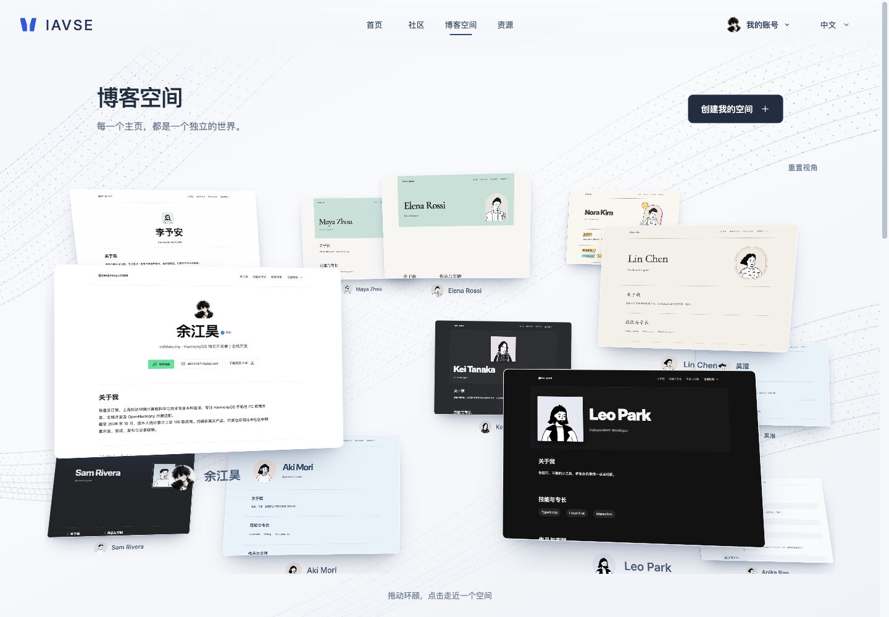

# IAVSE

[English](README.md) | **简体中文**

**以洞察驱动智能，以敏锐发现机遇，以行动实现进化。**

INSIGHT · ARTIFICIAL INTELLIGENCE · VIGILANCE · SEIZE · EVOLVE

Insight through AI. Vigilance for Opportunity. Seize to Evolve.

IAVSE 是面向开发者的博客主页与知识共享平台。将简历整理成可编辑的个人主页，展示经历、作品与证书；通过社区分享教程、独立 AI Skill 和实用工具。每个成员独立管理自己的资料、草稿和上传文件。

博客编辑器使用 MIT React Flow 直接设计主页，默认沿用现有 Anx 模板。支持行内编辑、栏目移动与宽度调整、自定义文字、图片及链接；预览和明确发布后的公开页使用同一份设计。HTML / ZIP 静态托管继续通过后端 API 提供。

[GitHub 仓库](https://github.com/IntMainJhy/IAVSE) · [AtomGit 镜像](https://atomgit.com/InMainJhy/IAVSE) · [文档导航](docs/README.md)

本仓库提供网站的完整前端、后端、测试及部署示例，方便阅读其界面、内容组织和权限治理的实现。网站基于 Next.js、React、TypeScript 和 Node.js 内置 SQLite 构建。

> **源码公开，允许非商业使用。** 网站原创部分采用 [PolyForm Noncommercial 1.0.0](LICENSE)，允许在其定义的非商业目的范围内使用、修改、部署和再分发，不授予商业用途许可。由于限制商业目的，它不属于 OSI 定义的开源许可。署名和适用范围见 [NOTICE](NOTICE)。

**本仓库只发布网站。macOS、Windows 客户端的源码、安装包和专有资源不在本仓库发布，本仓库的许可不授予客户端使用或分发权利。** GitHub 平台内的查看与 Fork 按适用的平台条款处理。

## 适合谁使用

- **开发者：**制作可分享的简历主页，展示项目、经历、技能与紧凑的证书相册。
- **作者与资源整理者：**发布分类教程、第三方 Skill 和实用资源，保留来源及许可说明。
- **使用 AI 的创作者：**通过限定权限的 REST 凭据或本地 stdio MCP，让已获授权的 Agent 保存草稿、提交发布。
- **网站运营者：**审核投稿文章，处理举报与下架，管理账号，查看真实访问统计并保留审计记录。

平台按多成员共享、账号数据隔离的方式开发。真实 HTTPS 部署可显式开放生产账号与社区；注册时必须打开并确认当前版本的社区规则和免责声明，之后可使用邮箱和密码登录，无需邮箱验证码。规则确认与邮箱所有权验证分别记录，账号限制及部署入口权限继续生效。参见[公开运营要求](docs/public-launch.md)。

## 当前版本

main 已汇总深蓝光学玻璃首页、macOS 下载入口、资源页转场和 12 个主页的 3D 博客展廊。展廊复用既有主题，每次最多加载两个预览，支持拖动环顾、点击靠近与减少动态效果；真实公开作者优先，展示资料不创建账号、不计入成员数量。

本轮检查与收尾见[最新审计及版本说明](docs/release-2026-11-02.md)。以下首页和空间展廊截图对应当前版本；社区与个人主页截图保留为历史参考。

## 界面预览

以下为本地网页端预览。首页与空间展廊使用本轮截图，其他存档画面仅供参考。

### 网站首页

当前光学玻璃首页，通过滚动依次介绍博客空间、可操作的编辑画布、Skill 与资源。


### 空间展廊



### 社区动态

分享信息流、成员推荐与分类导航。


### 博客主页

“博客空间”目录展示允许发现的已公开主页，每个主页使用作者保存的布局，呈现个人介绍、技能、经历与作品。编辑放在独立页面：「创建 / 编辑我的博客」进入当前登录成员自己的内容。站长可通过「管理后台 → 博客主页」访问 `/admin/blog`。详见[博客编辑指南](docs/blog-editor.zh-CN.md)。


## 网站功能

| 模块 | 可以做什么 |
| --- | --- |
| 账号注册 | 无需邀请码或邮箱验证码，使用邮箱和密码注册登录；注册前必须打开并确认当前社区规则和免责声明，服务端核对规则版本和摘要，不会因此将邮箱标记为已验证；生产入口需显式配置 |
| 博客主页 | 在真实 Anx 模板或空白页面上设计；行内编辑、图层、属性、宽度与位置、自定义元素、撤销重做、点阵背景及电脑/手机预览。保留简历、证书、PDF 和翻译；保存私有草稿后明确发布固定主页版本；文章内容仍需审核 |
| 已有静态网站托管 | 后端 API 接受 HTML 或包含相对路径 CSS / JS / 素材的 ZIP，提供隔离预览，明确发布固定主页版本，无需前置审核；已有托管站点及稳定分享地址继续支持 |
| 共享文档 | 标题与正文写作，支持斜杠插入、列表、代码、表格、按账号隔离的行内图片、导入及标题目录；仅文档在停止输入 1,600 毫秒后自动保存私人草稿，保存期间可继续输入；阅读采用文库、正文、目录布局 |
| Skill 目录 | 独立上游 Skill 支持分类、搜索、AI 工具筛选、使用场景、安装命令与多语言提示词；GSAP 合并为一个条目与八个模块，旧模块地址跳转。成员发布先填名称及 HTTPS 链接，简介选填，补充信息折叠 |
| 其他资源 | 名称与 HTTPS 链接即可分享网站、工具和参考资料，简介选填，补充资料折叠 |
| 发布与社区 | 原创分享只需正文，自动生成标题和摘要，补充资料可展开；发布仍须明确同意条款并遵循账号限制。社区文章和共享文档需要审核；博客布局、项目、Skill、资源、评论及留言直接发布。栏目公开后生成一条关联动态，修订复用，下架联动停止公开 |
| 分享与社区名片 | 博客拥有独立展示页，支持公开链接、系统分享和二维码；社区个人页保留简短介绍并连接完整博客 |
| 简历导入 | 本地解析 PDF、DOCX、TXT、Markdown 文本，先核对再应用到资料草稿；原文件保持私有，可单独选择脱敏 PDF 供公开下载 |
| 内容与文件 | 按账号隔离草稿、版本、博客内容、图片、附件和文件引用 |
| 审核与管理 | 文章及文档审核、发布后举报与下架、账号管理、通知和审计日志；仪表盘展示数据库中的注册用户、账号状态、新增用户、公开主页、内容、存储及实际 PV/UV，并支持按日期查看访问详情 |
| AI 工具接入 | IAVSE Skill 与本地 stdio MCP 可通过独立凭据读取、保存和提交文档、Skill、资源，使用与网页相同的审核及社区同步流程 |

网站下载页可以配置外部客户端安装包链接，安装包及客户端源码均不存放在本仓库。

## 界面与交互

深海蓝、钴蓝和瓷白构成首页与平台界面的共同视觉语言。首页使用实时 Three.js 玻璃曲面，通过折射、反射与克制的色散表现光线，随后过渡到粒子场。大屏使用 GSAP ScrollTrigger 驱动博客空间、编辑画布、Skill、资源四段连续场景，每段包含入场、停留和退场。画布是真正可操作的产品演示，Skill 卡片播放真实界面录制，资源卡片包含独立可交互的 3D 场景；鼠标悬停时提供局部点阵反馈。

顶栏采用左侧品牌、中间导航、右侧账号与语言的布局。移动端和减少动态模式保留原生文档滚动。未激活的场景不会初始化视频或 3D 卡片，已加载的媒体离场后暂停或按需渲染。全局及卡片暂停、减少动态、后台标签页挂起、加载失败回退与 GPU 资源清理共同控制不必要的开销。

界面提供中文、英文和日文，适配桌面、平板与手机。编辑器采用克制的蓝色强调与浅色工作区，自定义博客主题保留自身已保存的配色；桌面公开页遵循保存的设计，窄屏保持顺畅的顺序阅读。已有模板继续兼容，当前不提供实时协作。

静态托管支持 UTF-8 HTML（5MB）或 ZIP（压缩25MB、展开50MB、最多1000项），网站包需要 `index.html` 或 `index.htm`，素材使用相对路径。浏览器内交互在不透明来源的沙箱中运行；外部脚本、接口通信、表单提交和服务端执行均被阻止。源文件与解压文件均计入个人存储，每个账号最多保留20个不可变的网站包。博客布局和静态网站包由作者明确发布，无需前置审核；文章内容单独审核。文件归属、沙箱隔离、账号权限与投诉下架机制继续生效，生产入口由运维单独配置。备份保留源包，恢复时重新校验并重建静态素材。

旧 `/u/...` 地址跳转到公开博客；原工作区管理地址跳转到独立博客编辑器，原有内容与后端数据接口继续保留。打包方式、预览和交互范围见[静态托管指南](docs/blog-hosting.zh-CN.md)。

## 发布与 AI 工作流

平台连接首页、社区、博客空间和资源，文档与 Skill 可从资源导航进入。社区文章可以只填写正文，标题和摘要自动生成，链接和补充信息选填。社区文章与共享文档统一进入审核，不因本地初筛未发现风险而自动通过。博客主页布局、静态网站、项目、Skill 和资源在明确点击发布后直接公开，评论和留言也不需要前置审核。

保存始终是私有操作。公开版本是固定快照，后续编辑保持为草稿，直到作者再次发布或文章修订通过审核。栏目内容发布后自动生成一条关联社区动态，后续修订复用该动态，无需重复投稿。每份公开内容保留作者、来源和使用许可；未上传图片时由平台生成文字封面。

简化前置审核不移除账号限制、危险链接校验、内容清理、文件归属检查、提交限流、举报和管理员下架。本地初筛提供治理线索，并非语义 AI 审核或合规认证。正式环境仍受部署入口权限控制，参见[公开运营要求](docs/public-launch.md)。

需要 AI 发布时，已登录的账号可通过已登录的 `/api/spaces/keys` API 创建 **catalog** 范围凭据；只有允许 Agent 提交发布时才添加 **submit**。原 `/workspace/connect` 页面目前跳转到博客编辑器，不能作为可用的凭据管理界面。操作字段见[凭据配置](integrations/spaceyew-post/references/api.md#credential-setup-local-accounts)。已有内容库或社区凭据不会自动扩大权限。在私密配置中为 [stdio MCP](integrations/spaceyew-mcp.mjs) 或 [IAVSE Skill](integrations/spaceyew-post/SKILL.md) 配置网站地址与令牌。流程为先 `catalog.save`，读取当前规则并获得发布授权后再 `catalog.submit`。接口返回真实的已发布或待复核状态，Agent 不能自行审批；写入请求的幂等标识避免重试产生重复内容。字段与 MCP 配置见 [API 参考](integrations/spaceyew-post/references/api.md)。

精选目录仅索引第三方原仓库，不打包第三方源码，避免重复收录 AI 工具自带的 Skill，并已移除此前的 Anthropic 示例及文档 Skill。工具标签表示本站整理的安装路径，不代表通用兼容性保证。GSAP Skills 采用 MIT，GSAP 运行库另有自身许可。

### 一次完整的发布流程

1. 注册时打开并确认社区规则及免责声明，之后使用邮箱和密码登录，从相应栏目或「创建 / 编辑我的博客」打开编辑器。
2. 填写内容，核对简历提取结果、清除私密信息并预览草稿。
3. 保存私有草稿，再明确提交发布；文章和文档进入审核，其他支持的内容直接公开。仅保存不会发布。
4. 公开后分享链接；目录内容会自动生成关联社区动态。
5. 后续修订保留为私有草稿，再次发布或提交文章审核后才替换公开快照；需要时可以下线。

## 技术实现

| 层级 | 实现 |
| --- | --- |
| 页面与 API | Next.js 15 App Router，服务端页面与同站 API |
| 界面 | React 19、TypeScript 5、CSS、GSAP、ScrollTrigger |
| 3D 与媒体 | Three.js、React Three Fiber、GLB 模型、Shader 与延迟加载视频 |
| 富文本编辑 | Tiptap |
| 运行与数据 | Node.js 24.15+、内置 SQLite、私有文件目录 |
| 邮件与媒体 | Nodemailer、Sharp、QRCode |
| 验证与部署 | Node.js 测试运行器、隔离 HTTP 测试、Nginx 与 systemd 示例 |

## 当前状态

项目仍处于开发阶段，持续完善网站功能、交互与维护流程。公开源码用于展示和阅读实现，不代表已完成生产部署、邮件投递或社区开放验收。

本仓库只承载网站开发；macOS 和 Windows 客户端继续保持私有。没有在仓库提供的客户端源码、安装包或真实站点数据，不属于本项目的交付内容。

[2026-10-22 审计记录](docs/audit-2026-10-22.md) 列出了此前一次检查的范围及验证结果，包含 162 项单元测试、类型检查、生产构建和三组 HTTP 测试。结果仅对应当时的版本与环境，不代表生产可用性保证。

## 使用文档

| 要做什么 | 对应指南 |
| --- | --- |
| 注册账号与配置发信 | [邮箱注册与 SMTP](docs/email-registration.md) |
| 编辑与发布博客 | [博客编辑](docs/blog-editor.zh-CN.md) |
| 安全导入简历 | [简历导入](docs/resume-import.zh-CN.md) |
| 了解静态托管 | [托管与沙箱限制](docs/blog-hosting.zh-CN.md) |
| 连接 AI 工具 | [API 与 stdio MCP 参考](integrations/spaceyew-post/references/api.md) |
| 管理及部署 | [管理中心](docs/管理中心说明.md) · [部署](deploy/README-split.md) |
| 检查上线边界 | [审核与上线](docs/moderation-and-launch.md) · [审计记录](docs/audit-2026-10-22.md) |
| 了解图标与授权 | [品牌素材](docs/brand.md) · [第三方许可](THIRD_PARTY_NOTICES.md) |

## 目录

| 目录 | 内容 |
| --- | --- |
| `src/app/` | 页面、API、媒体/下载路由与样式 |
| `src/components/` | 网站界面及共享交互 |
| `src/lib/` | 认证、内容、社区、空间、文件、邮件、数据库与权限 |
| `test/` | 单元测试与使用临时数据的隔离 HTTP 测试 |
| `scripts/` | 初始化、备份、恢复、清理与 Skill 打包 |
| `integrations/` | 网站投稿 Skill、MCP 与请求脚本 |
| `deploy/` | Nginx、systemd 与平台/管理分入口部署示例 |
| `public/` | 网站静态资源与生成的投稿 Skill 包 |
| `docs/` | 网站管理说明、界面截图与第三方许可 |

本地数据库、用户上传、邮件记录、真实环境变量、凭据、备份、设计验收截图、临时预览、依赖和构建输出均不在仓库中。运行时演示账号、自动免登录与演示播种脚本已移除。自动回归测试保留临时测试数据，不使用现有站点凭据。

## 本地开发

可以按以下命令进行 LICENSE 所允许的非商业开发和部署；商业用途需另行授权。操作说明不扩大许可范围。

要求 Node.js **24.15 或更新的兼容版本**，使用 npm 和随仓库提供的锁文件。数据库采用单 Node 进程访问，不应以多个实例共写同一上传目录。

```sh
git clone https://github.com/IntMainJhy/IAVSE.git
cd IAVSE
npm ci
cp .env.local.example .env.local
node --env-file=.env.local scripts/setup.mjs
npm run dev
```

默认本地入口为 `http://127.0.0.1:3008/`。此仓库本身就是网站根目录，无需再进入 site-v1 子目录。如果已有环境文件，不要覆盖它。

`APP_DATA_DIR` 默认位于应用目录之外的 `../.site-v1-data`，可设置为其他私有绝对路径。首次初始化创建随机管理员凭据文件 `initial-admin.txt`，仅存放在实际数据目录；已有数据不会因重复 setup 自动重置。不要上传该文件、数据库或真实配置。

继续使用已有站点时，在本机 `.env.local` 中固定 `APP_DATA_DIR=/absolute/path/to/existing-data`，并让 `PUBLIC_URL` 与浏览器使用的主机名、端口一致。修改后重启服务。若启动后突然出现默认资料、演示账号或头像缺失，先核对实际数据目录；指向另一目录会打开另一份数据库，并不代表原资料已被删除，不要用空库覆盖原库。直接执行 Node 脚本时需使用 `node --env-file=.env.local scripts/setup.mjs` 或显式传入环境变量；普通 Node 不会自动读取 `.env.local`。

本地环境模板只包含 loopback URL 与 Cookie 配置。注册无需 SMTP；需要邮箱所有权验证和密码找回功能时，参照 [.env.example](.env.example) 配置 SMTP；本机 capture 模式只用于联调。真实 SMTP 投递、备份恢复及正式部署需在目标环境单独验证。

```sh
npm test
npm run typecheck
npm run build
npm run test:homepage:http
npm run test:resume:http
npm run test:blog-editor:http
npm run test:registration:http
npm start
```

HTTP 集成脚本位于 `test/`，使用临时数据目录执行；运行前确认测试端口未被开发服务占用。测试自行创建并清理账号和内容，不得指向已有站点的数据目录。

## 部署与管理

建议复用一份代码和数据库，分别部署平台与管理子域名，以 `APP_SURFACE`、独立会话和服务端权限隔离。管理员只登录管理端，普通成员从平台登录；已移除任意账号体验登录及演示免登录。

- [平台/管理分入口部署](deploy/README-split.md)
- [管理中心说明](docs/管理中心说明.md)
- 配置示例：[平台](deploy/platform.env.example)、[管理](deploy/admin.env.example)、[Nginx](deploy/nginx-split.conf.example)。

正式环境须使用独立私有数据目录、正确的 HTTPS URL、Secure Cookie 及可信代理配置。客户端链接、备案展示、账号与邮件设置需与实际站点一致；代码中的默认资料与备案标识不可作为其他站点的授权证明。

## 许可与授权

网站原创部分采用 [PolyForm Noncommercial 1.0.0](LICENSE)，允许非商业目的的使用、修改和再分发，包括许可中定义的个人用途和组织使用；商业用途不在授权内。超出许可范围时，可通过 [IntMainJhy](https://github.com/IntMainJhy) 的公开联系渠道另行申请授权。LICENSE 保留官方英文原文，中文说明不替代许可条款；再分发须保留 [NOTICE](NOTICE) 中的著作权声明。

第三方材料继续适用各自许可，参见 [THIRD_PARTY_NOTICES.md](THIRD_PARTY_NOTICES.md)。

- [社区收尾与账号隔离记录](docs/community-finish-2026-10-22.md)
